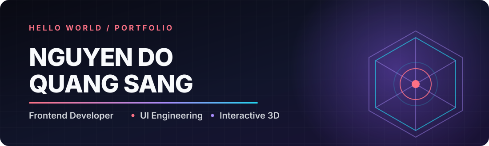
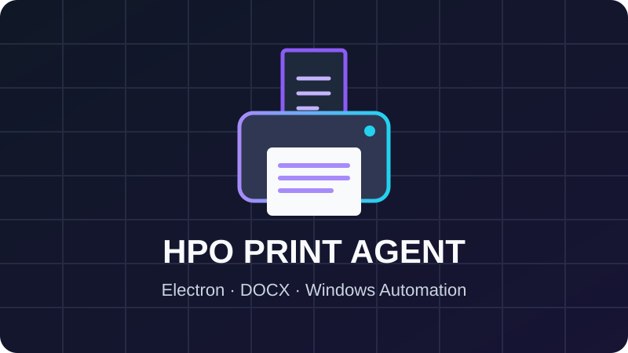

<!-- GitHub Profile README — Nguyễn Đỗ Quang Sáng -->

  

  <h1>Hi there, I'm Nguyễn Đỗ Quang Sáng 👋</h1>
  
<strong>Frontend Developer · UI Engineering · Interactive 3D</strong>

  
Building thoughtful interfaces, practical web applications, and interactive experiences.

  

    
    
    
  

---

### 👨‍💻 About me

I'm a **Frontend Developer based in Ho Chi Minh City, Vietnam**, with 2+ years of hands-on experience in responsive web development, turning designs into clean interfaces, and customizing WordPress themes.

- 🎨 I turn **Figma / Photoshop / Adobe XD designs** into responsive, pixel-precise interfaces.
- ⚡ I build with **HTML, CSS, JavaScript, TypeScript, React, Next.js**, and modern UI tooling.
- 🧊 I explore **Three.js, procedural 3D modeling, WebGL, and interactive web experiences**.
- 🛠️ I also work on **admin dashboards, automation tools, and desktop integrations**.
- 🤖 I use AI-assisted workflows to prototype, debug, and iterate thoughtfully.

### 🧰 Tech stack

  

| Focus | Technologies & practices |
|:--|:--|
| **Frontend** | HTML5, CSS3, JavaScript, TypeScript, React, Next.js, Tailwind CSS, jQuery |
| **UI / CMS** | Responsive design, pixel-perfect implementation, WordPress custom themes, Figma |
| **Creative coding** | Three.js, WebGL, procedural geometry, animation, GLB / OBJ workflows |
| **Applications & tools** | Node.js, Electron, REST APIs, Git / GitHub, AI-assisted development |

### 🚀 Featured projects

<table>
  <tr>
    <td width="50%" valign="top">
      
      <h3><a href="https://github.com/quangsang28102/HPO.EDU.V2">HPO EDU · Education Website</a></h3>
      
Multi-page driving education website featuring reusable UI elements, training information, online lookup flows, and an interactive Three.js robot companion.

      
<code>HTML</code> <code>CSS</code> <code>JavaScript</code> <code>Three.js</code>

    </td>
    <td width="50%" valign="top">
      
      <h3><a href="https://github.com/quangsang28102/AVATAR">AVATAR · Stylized 3D Characters</a></h3>
      
Low-poly procedural characters built with Three.js, including 360° viewing, animation, pose controls, and GLB / OBJ export workflows.

      
<code>Three.js</code> <code>WebGL</code> <code>Procedural 3D</code>

    </td>
  </tr>
  <tr>
    <td width="50%" valign="top">
      
      <h3><a href="https://github.com/quangsang28102/footballPay">FootballPay · Team Finance Dashboard</a></h3>
      
Manage players, matches, and shared payments with dashboards, filtering, and Google Sheets synchronization functionality.

      
<code>Next.js</code> <code>React</code> <code>TypeScript</code>

    </td>
    <td width="50%" valign="top">
      
      <h3><a href="https://github.com/quangsang28102/PRINT.AGENT">HPO Print Agent · Desktop Automation</a></h3>
      
Windows desktop app connecting to exam services, filling DOCX templates, and sending print jobs through Microsoft Word.

      
<code>Electron</code> <code>Node.js</code> <code>Socket.IO</code>

    </td>
  </tr>
</table>

### 🗂️ More things I've built

| Repository | What you'll find |
|:--|:--|
| [**Theory-Admin**](https://github.com/quangsang28102/Theory-Admin) | React / TypeScript admin interface with modules for dashboards, exam batches, exams, and students. |
| [**porfolio**](https://github.com/quangsang28102/porfolio) | Personal portfolio site with Next.js, Tailwind CSS, and Framer Motion. |

> Only public projects are linked here. Other projects and experiments remain private.

### 📊 GitHub activity

  

Activity graphic is generated by an external service and may occasionally be unavailable. GitHub's built-in contribution calendar is available on the profile as well.

### 🤝 Let's connect

If you're working on a **beautiful interface, a web application, or an interactive 3D idea**, feel free to reach out.

📍 Ho Chi Minh City, Vietnam  
📬 **[qsang.dev@gmail.com](mailto:qsang.dev@gmail.com)**  
🔗 **[Browse my repositories](https://github.com/quangsang28102?tab=repositories)**

  Designed with care · Keep learning, keep building.

