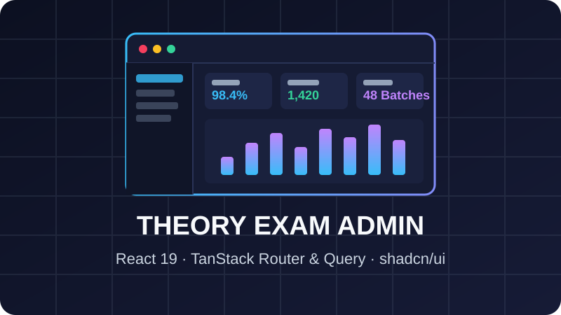
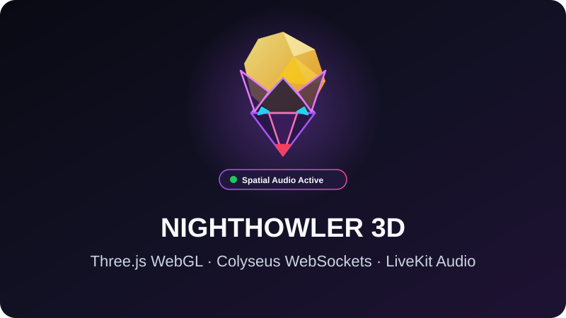

<!-- GitHub Profile README — Nguyễn Đỗ Quang Sáng -->

  

  <h1>Hi there, I'm Nguyễn Đỗ Quang Sáng 👋</h1>
  
<strong>Frontend Developer · Cắt Layout Pixel-Perfect (W3C Standards) · WordPress Custom Themes · Interactive 3D</strong>

  
Transforming complex design files into responsive, high-performance web experiences with clean code & AI-augmented workflows.

  

    
    
    
    
  

---

### 👨‍💻 About Me

I'm a **Frontend Developer based in Ho Chi Minh City, Vietnam**, with 2+ years of hands-on experience converting complex designs into semantic, cross-browser responsive interfaces, engineering production-ready WordPress themes, and exploring interactive 3D WebGL experiences.

- 📐 **Pixel-Perfect & W3C Standards:** Converting **Figma, Photoshop, Adobe XD, and Illustrator** mockups into semantic HTML5, CSS3/SCSS, and interactive jQuery / JavaScript with 100% responsiveness across all device viewports.
- ⚙️ **Custom WordPress Engineering:** Developing bespoke WordPress themes from static HTML prototypes, configuring Advanced Custom Fields (ACF Pro), building **Flatsome Child Themes**, and engineering modular UX Builder elements.
- ⚡ **Core Web Vitals & Performance:** Dedicated to zero Cumulative Layout Shift (CLS = 0), optimized LCP, deferred non-blocking assets, clean output escaping, and defensive programming.
- 🤖 **AI-Augmented Velocity:** Proficient in integrating modern AI assistants (**GitHub Copilot, Claude, ChatGPT, Gemini**) to accelerate delivery speed, maintain clean code standards, and streamline debugging.
- 🧊 **Creative 3D & Systems:** Hands-on experience with **Three.js, WebGL, React 19, Next.js 15, TypeScript**, and **Electron desktop automation**.

---

### 🧰 Tech Stack & Skills

  

 

| Domain | Technologies & Competencies |
| :--- | :--- |
| **Frontend Core** | HTML5 (Semantic & W3C compliant), CSS3 / SCSS (Flexbox, Grid), JavaScript (ES6+), jQuery, Bootstrap, Tailwind CSS |
| **WordPress & CMS** | Custom Theme from static HTML, Flatsome Child Themes, ACF Pro, Custom Post Types (CPT), Theme Customizer, PHP |
| **Design-to-Code** | Figma, Adobe Photoshop, Adobe Illustrator, Adobe XD (Pixel-perfect slicing, responsive UI layout) |
| **3D & Creative Coding** | Three.js, WebGL, Procedural BufferGeometry, Real-time Shaders, OrbitControls, glTF / OBJ workflows |
| **Modern Stack & Tools** | React 19, Next.js 15, TypeScript, TanStack Router/Query, Node.js, Electron, Git / GitHub, AI Coding Assistants |
| **Optimization & Standards**| Core Web Vitals (CLS = 0, LCP), Cross-Browser Compatibility, W3C Validation, Output Escaping & Sanitization |

---

## 🚀 Featured Projects Showcase

### 🌟 1. Web Production, Layout W3C & WordPress CMS

Enterprise-ready websites, custom themes, and administrative dashboards focused on pixel precision, speed, and maintainability.

<table>
  <tr>
    <td width="50%" valign="top">
      
      <h3><a href="https://github.com/quangsang28102/HPO.EDU.V2">HPO EDU · Multi-Page Education Portal</a></h3>
      
Production multi-page website converted from design mockups. Built with semantic HTML5, CSS3, modular JavaScript/jQuery, and W3C standard compliance across all desktop & mobile viewports.

      
<code>HTML5 (W3C)</code> <code>CSS3 / SCSS</code> <code>jQuery</code> <code>Responsive</code>

      
👉 <a href="https://github.com/quangsang28102/HPO.EDU.V2">View Repository</a>

    </td>
    <td width="50%" valign="top">
      
      <h3><a href="https://github.com/quangsang28102/BITCO">BITCO · Custom WordPress Theme from HTML</a></h3>
      
Enterprise industrial website converted from static HTML templates into a fully dynamic WordPress theme. Features ACF Pro data sync, Custom Post Types, sanitized inputs, and WordPress PHP Coding Standards.

      
<code>WordPress Theme</code> <code>PHP</code> <code>ACF Pro</code> <code>HTML-to-WP</code>

      
👉 <a href="https://github.com/quangsang28102/BITCO">View Repository</a>

    </td>
  </tr>
  <tr>
    <td width="50%" valign="top">
      
      <h3><a href="https://github.com/quangsang28102/CUSTOM_FLATSOME_THEME">Flatsome Child Theme · Architecture & Optimization</a></h3>
      
Modular child theme architecture with custom UX Builder elements and shortcodes. Engineered for high performance: zero CLS, optimized LCP, deferred scripts, and clean WP bloatware removal.

      
<code>Flatsome Child Theme</code> <code>UX Elements</code> <code>Core Web Vitals</code> <code>PHP</code>

      
👉 <a href="https://github.com/quangsang28102/CUSTOM_FLATSOME_THEME">View Repository</a>

    </td>
    <td width="50%" valign="top">
      
      <h3><a href="https://github.com/quangsang28102/Theory-Admin">Theory-Admin · Examination Management System</a></h3>
      
Modern administrative dashboard built with React 19, TanStack Router with file-based routing, TanStack Query for server state caching, TailwindCSS v4, and accessible shadcn/ui components.

      
<code>React 19</code> <code>TypeScript</code> <code>TanStack Router & Query</code> <code>shadcn/ui</code>

      
👉 <a href="https://github.com/quangsang28102/Theory-Admin">View Repository</a>

    </td>
  </tr>
</table>

---

### 🧊 2. Creative Coding, Interactive 3D & WebGL

High-impact 3D graphics, procedural mathematical geometry, and real-time multiplayer spatial interactions.

<table>
  <tr>
    <td width="50%" valign="top">
      
      <h3><a href="https://github.com/quangsang28102/AVATAR">AVATAR · Procedural 3D Character Collection</a></h3>
      
Interactive browser-based 3D WebGL experience: Stylized characters generated 100% mathematically using Three.js BufferGeometry (&lt;250KB payload), 360° orbital camera, real-time Fresnel shaders, and client-side GLB/OBJ export.

      
<code>Three.js</code> <code>WebGL</code> <code>BufferGeometry</code> <code>GLB / OBJ Export</code>

      
🌐 <a href="https://avatar-three-rouge.vercel.app/">Live Demo</a> · 👉 <a href="https://github.com/quangsang28102/AVATAR">View Repository</a>

    </td>
    <td width="50%" valign="top">
      
      <h3><a href="https://github.com/quangsang28102/NightHowler">NightHowler · 3D Realtime Werewolf Arena</a></h3>
      
Fullstack realtime multiplayer 3D gaming platform built with Monorepo architecture, WebGL/Three.js, Colyseus WebSockets for authoritative state sync, and LiveKit WebRTC for partitioned spatial voice chat per game phase.

      
<code>Three.js</code> <code>Colyseus WebSockets</code> <code>LiveKit WebRTC</code> <code>TypeScript Monorepo</code>

      
👉 <a href="https://github.com/quangsang28102/NightHowler">View Repository</a>

    </td>
  </tr>
</table>

---

### ⚡ 3. Fullstack Applications & Desktop Automation

Practical web applications and desktop integrations solving real-world operational problems.

<table>
  <tr>
    <td width="50%" valign="top">
      
      <h3><a href="https://github.com/quangsang28102/footballPay">FootballPay · Sports Finance Dashboard</a></h3>
      
Fullstack team management dashboard built with Next.js App Router and React. Features dynamic payment QR generation (VietQR) with prefilled reference notes and bidirectional Google Sheets API sync.

      
<code>Next.js 15</code> <code>React 19</code> <code>TypeScript</code> <code>VietQR</code> <code>Google Sheets API</code>

      
🌐 <a href="https://football-pay.vercel.app/">Live Demo</a> · 👉 <a href="https://github.com/quangsang28102/footballPay">View Repository</a>

    </td>
    <td width="50%" valign="top">
      
      <h3><a href="https://github.com/quangsang28102/PRINT.AGENT">HPO Print Agent · Desktop Automation System</a></h3>
      
Windows desktop application connecting to exam servers via Socket.IO. Automatically extracts candidate data, fills Word DOCX certificate templates, and drives Microsoft Word COM print spooler queues without manual intervention.

      
<code>Electron</code> <code>Node.js</code> <code>Socket.IO</code> <code>Windows Automation</code>

      
👉 <a href="https://github.com/quangsang28102/PRINT.AGENT">View Repository</a>

    </td>
  </tr>
</table>

---

### 🗂️ 4. Personal Showcase & Open Source Experiments

| Project | Tech Stack | Highlights |
| :--- | :--- | :--- |
| [**Portfolio CV**](https://github.com/quangsang28102/porfolio) | `Next.js 15` `Tailwind CSS` `Framer Motion` | Modern developer portfolio featuring strict TypeScript, interactive terminal, spotlight cards, and dark theme. |
| [**PokemonLoading**](https://github.com/quangsang28102/PokemonLoading) | `TypeScript` `CSS3 Animations` | Interactive Pokémon Pokéball loading animation practice built with pure TypeScript and CSS keyframes. |
| [**WebDemoMovie**](https://github.com/quangsang28102/WebDemoMovie) | `JavaScript` `RESTful API` | Movie discovery web interface integrated with The Movie Database (TMDB) API. |

---

### 📊 GitHub Activity & Discipline

  

 

  

---

### 🤝 Contact & Connect

If you are looking for a **dedicated Frontend Developer** skilled in **pixel-perfect layout cutting**, **custom WordPress engineering**, **interactive 3D experiences**, and **high-efficiency AI-assisted workflows**, feel free to reach out!

- 📍 **Location:** Ho Chi Minh City, Vietnam
- 📬 **Email:** [qsang.dev@gmail.com](mailto:qsang.dev@gmail.com)
- 🔗 **GitHub Repositories:** [github.com/quangsang28102](https://github.com/quangsang28102?tab=repositories)
- 🌐 **Facebook:** [fb.com/NGUYENDOQUANGSANG](https://www.facebook.com/NGUYENDOQUANGSANG/)

  Designed with care & precision · Clean Code · Better Future

